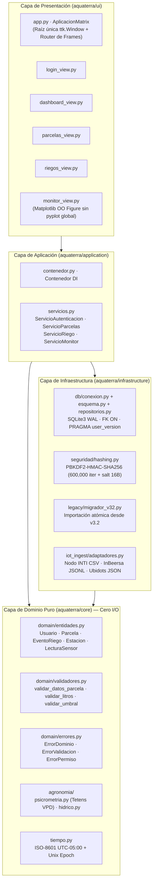

# REP-001: Fase 1 — Re-Arquitectura Modular v4.0, Motor SQLite WAL, Ingesta IoT y Cierre Total de Deuda Técnica

- **Fecha:** `2026-11-13`
- **Versión:** `v4.0.0a1`
- **Rama:** `develop`
- **Autor:** Daniel Felipe Duque Lizarralde

---

## 1. Resumen Ejecutivo
Se ejecutó la transformación estructural de **AquaUTP v3.2** (scripts acoplados sobre CSV/JSON planos) hacia **AquaTerra Matrix v4.0.0a1**: una arquitectura modular en 4 capas con persistencia transaccional en **SQLite3 (modo WAL)**, seguridad criptográfica **PBKDF2-HMAC-SHA256**, psicrometría agronómica ($VPD$ por ecuación de Tetens FAO-56), adaptadores nativos de ingesta para las estaciones **TerraBit Nodo INTI**, **InBeersa** y **Ubidots**, y una suite de **47 pruebas automatizadas** (incluyendo pruebas de humo de la interfaz gráfica y pruebas de no-fuga de memoria).

---

## 2. Nueva Arquitectura del Paquete `aquaterra/`

---

## 3. Detalle Paso a Paso de Mejoras y Correcciones Implementadas

### 3.1. Resolución de Deuda Técnica (DT-01 a DT-05)

1. **DT-01 — Integridad Referencial e Inmutabilidad de IDs (`aquaterra/infrastructure/db/esquema.py` & `repositorios.py`):**
   - **Problema en v3.2:** `eliminar_parcela()` renumeraba los IDs de las parcelas restantes con `range(1, len + 1)`, dejando los eventos de `riegos.json` apuntando a parcelas equivocadas.
   - **Solución:** Las llaves primarias son `INTEGER PRIMARY KEY AUTOINCREMENT` y jamás se reutilizan ni renumeran. Además, `eventos_riego.parcela_id` tiene restricción `ON DELETE RESTRICT` con `PRAGMA foreign_keys = ON`. Cuando el administrador elimina una parcela en la interfaz, se ejecuta un **archivado lógico (`activa = 0`)** que preserva intacto todo el historial hídrico.
   - **Mejora adicional:** El gráfico de consumo acumulado en `RepositorioRiegos.consumo_por_parcela()` ahora agrupa por `parcelas.id` (`GROUP BY p.id`) en lugar de agrupar por el texto del nombre; así, si se corrige o renombra una parcela, su serie histórica de litros no se fragmenta.

2. **DT-02 — Motor SQLite3 en Modo WAL + Estandarización Temporal ISO-8601 (`aquaterra/infrastructure/db/` & `aquaterra/core/tiempo.py`):**
   - **Problema en v3.2:** Reescritura completa de `parcelas.csv` y `riegos.json` en cada operación y fechas en formato `MM/DD/YY` (`11/27/25`).
   - **Solución:**
     - Conexión SQLite configurada con `PRAGMA journal_mode = WAL`, `PRAGMA synchronous = NORMAL`, `PRAGMA foreign_keys = ON` y `PRAGMA busy_timeout = 5000`.
     - Migraciones deterministas mediante `PRAGMA user_version` (`esquema.py`).
     - Primer arranque inteligente (`contenedor.py` + `migrador_v32.py`): si la base `data/runtime/aquaterra.db` está vacía, importa automáticamente en una sola transacción atómica los datos semilla de `legacy/aquautp_v3.2/data/`, convirtiendo las fechas `MM/DD/YY` a **ISO-8601 con zona de Colombia (`YYYY-MM-DDTHH:MM:SS-05:00`)** + **Unix Epoch (`ts_epoch`)**.
     - **Atomicidad transaccional en el riego:** En v3.2 actualizar la humedad de la parcela y guardar el evento de riego eran dos escrituras separadas en archivos distintos. Ahora ocurren dentro de un bloque `with self._db:` en `ServicioRiego.aplicar_riego()`; si cualquier paso falla, SQLite hace *rollback* automático (verificado con `test_riego_es_atomico_si_falla_el_evento`).

3. **DT-03 — Validación Unificada de Dominio (`aquaterra/core/domain/validadores.py`):**
   - **Problema en v3.2:** `_accion_actualizar()` no validaba los campos del formulario.
   - **Solución:** Se creó `validar_datos_parcela()`, invocada tanto por `ServicioParcelas.crear()` como por `ServicioParcelas.actualizar()`. Soporta coma decimal (`"12,5"` $\to$ `12.5`), limpia espacios repetidos, verifica rangos físicos (`0 < area_m2 <= 10,000,000`, `0 <= humedad_pct <= 100`), impide nombres duplicados entre parcelas activas y acumula todos los errores de validación en una sola respuesta clara.

4. **DT-04 — Erradicación de Fuga de Memoria en Gráficos (`aquaterra/ui/views/monitor_view.py`):**
   - **Problema en v3.2:** `plt.subplots()` registraba figuras en el gestor estático global `_pylab_helpers.Gcf` sin destruirlas nunca.
   - **Solución:** Se reemplazó `matplotlib.pyplot` por instanciación directa orientada a objetos de `matplotlib.figure.Figure(figsize=(5, 4), dpi=100)` y se sobreescribió `VistaMonitor.destroy()` para limpiar cada figura (`figure.clear()`) y destruir su widget Tk. La prueba `test_regresion_dt04_monitor_no_fuga_figuras` abre y cierra el monitor 15 veces seguidas y comprueba con `weakref` y `gc.collect()` que quedan `0` figuras vivas en RAM.

5. **DT-05a & DT-05b — Bucle Único de Eventos Tk y Hashing Criptográfico PBKDF2 (`aquaterra/ui/app.py` & `aquaterra/infrastructure/seguridad/hashing.py`):**
   - **Problema en v3.2:** Dos llamadas a `mainloop()` sobre ventanas distintas y contraseñas en texto claro (`"1234"`).
   - **Solución UI:** `AplicacionMatrix` mantiene una única ventana raíz `ttk.Window(themename="bootstrap-dark")` e intercambia vistas derivadas de `ttk.Frame`. Cerrar sesión desmonta el Dashboard y vuelve a montar `VistaLogin` limpiamente sobre la misma raíz. Además, se migraron los estilos heredados de `ttkbootstrap 1.x` (`superhero`, `inverse-secondary`, `inverse-info`) a los tokens modernos de `ttkbootstrap 2.2+` (`bootstrap-dark`, `@secondary`, `@info`), eliminando el 100% de los `DeprecationWarning`.
   - **Solución Seguridad:** `generar_hash()` aplica `hashlib.pbkdf2_hmac('sha256', ...)` con **600,000 iteraciones** (estándar OWASP), salt criptográfico de 16 bytes por usuario (`secrets.token_bytes`) y comparación en tiempo constante (`hmac.compare_digest`). Incluye actualización automática (*rehash on login*) si en el futuro se incrementa el número de iteraciones.

---

### 3.2. Nuevas Capacidades Científicas e IoT Incluidas en v4.0.0a1

1. **Módulo Psicrométrico (`aquaterra/core/agronomia/psicrometria.py`):**
   - Implementación de la ecuación de **Tetens (FAO-56 ec. 11)** para presión de vapor a saturación $e_s(T)$, déficit de presión de vapor $VPD$ en $\text{kPa}$ y clasificador agronómico en 5 zonas (`riesgo_fungico`, `propagacion`, `optima`, `floracion`, `estres_hidrico`).
2. **Adaptadores de Ingesta IoT (`aquaterra/infrastructure/iot_ingest/adaptadores.py`):**
   - `parsear_csv_nodo_inti()`: Lee el `/data.csv` real de 10 columnas generado por el firmware de `Estacion_TerraBit_Inti`, descarta tramas con `RTC_OFF` y normaliza las 8 variables físicas a `LecturaSensor`.
   - `parsear_jsonl_inbeersa()`: Lee el `/data.json` (JSONL) de `Estacion_InBeersa` y etiqueta automáticamente con `calidad = 2` (inválido) las lecturas anómalas del bus 1-Wire como `-200.0 °C` para que no contaminen promedios ni gráficas.
   - `parsear_payload_ubidots()`: Decodifica tanto los JSON con `{"value": ..., "timestamp": ms}` de la cola FIFO RTC del Nodo INTI como los JSON compactos de InBeersa, deduplicando en base de datos mediante `UNIQUE (estacion_id, variable, ts_epoch)`.
3. **Bitácora de Auditoría en Base de Datos (`tabla auditoria`):**
   - Cada inicio de sesión (exitoso o fallido), creación, edición, archivado de parcela, riego manual o migración queda registrado con usuario, timestamp ISO-8601 y payload JSON del cambio.

---

## 4. Métricas de Calidad y Verificación

- **Pruebas Automatizadas (`pytest`):** `47 passed, 0 warnings` (100% de éxito).
- **Análisis Estático (`ruff check`):** `All checks passed!` (0 errores de estilo, imports o bugs potenciales).
- **Dependencias de Producción reducidas:** Se retiraron `pandas`, `openpyxl` y `tkcalendar` del runtime principal (ver `ADR-001`), reduciendo el peso y tiempo de arranque de la aplicación.
