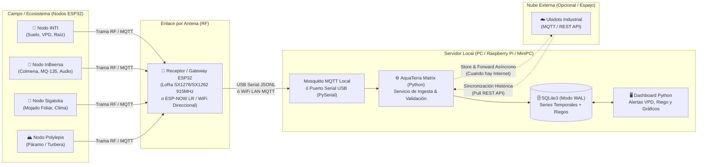

# Arquitectura de Telemetría por Antena, Servidor Local e Integración con Ubidots

**Proyecto:** AquaTerra Matrix — Ecosistema TerraBit  
**Autor & Arquitecto:** Daniel Felipe Duque Lizarralde  

---

## 1. ¿Cómo sirve esta Infraestructura Local para la Telemetría por Antena (Nodo $\to$ Servidor)?

Cuando despliegues nodos en campo abierto (cultivos de plátano para **Sigatoka**, meliponarios para **InBeersa**, parcelas agrícolas con **Nodo INTI** o turberas de **Páramo / Polylepis**), **el WiFi directo hacia Internet es el eslabón más débil y costoso energéticamente**:
1. En el firmware actual de `Estacion_TerraBit_Inti` (`cloud_mqtt.cpp`), acoplarse al WiFi consume hasta ~180–250 mA durante varios segundos y está limitado al alcance del router (~50–80 m con línea de vista).
2. En zonas rurales o de alta montaña, la conexión a Internet (4G/Starlink/ISP rural) sufre microcortes constantes.

Al construir **AquaTerra Matrix** como un **Servidor Central Local en Python (Edge Server / Estación Base)** con **SQLite en modo WAL**, obtienes el cerebro exacto donde aterriza tu antena receptora:



### Ventajas Críticas de tener tu Servidor Matriz Local:
1. **Soberanía de Datos y Cero Pérdida (*Offline-First*):** Si se cae el Internet en la finca o estación biológica durante 15 días, la antena sigue recibiendo cada paquete cada 5 minutos (288 muestras/día por nodo) y **AquaTerra Matrix** los guarda inmediatamente en SQLite local sin perder un solo punto ni depender de límites de créditos o *rate-limits* de Ubidots.
2. **Ahorro Drástico de Batería en los Nodos:** Transmitir un paquete por **LoRa (915 MHz)** o **ESP-NOW Long Range** hacia tu antena local toma **50 ms a 150 ms** (frente a los 3,000–8,000 ms de handshake WiFi + DHCP + DNS + TCP + MQTT hacia Ubidots). Eso multiplica por $5\times$ a $10\times$ la autonomía de las baterías LiFePO4/LiPo en campo.
3. **Automatización en Lazo Cerrado en Tiempo Real:** Si el Nodo INTI reporta por antena que la humedad cayó del umbral crítico y el $VPD > 1.6\text{ kPa}$, **AquaTerra Matrix** puede disparar la orden de riego en milisegundos dentro de la red local sin depender de que el dato viaje a los servidores de Ubidots en EE. UU. y regrese.
4. **Ingesta Híbrida (Antena + MicroSD):** Para estaciones ultra-remotas (Páramos) o archivos pesados (audios WAV de 32-bit de **InBeersa** o históricos `/data.csv` de **Nodo INTI**), el mismo motor de base de datos recibe tanto los paquetes en vivo de la antena como la importación masiva desde tarjeta MicroSD o descarga HTTP (`http://inbeersa.local/descargar-datos`).

---

## 2. ¿Cómo se Conecta Todo lo que Actualmente Llega a Ubidots?

Actualmente, tus firmwares (`Estacion_TerraBit_Inti` y `Estacion_InBeersa`) publican por MQTT a `industrial.api.ubidots.com` (puerto `1883`) en tópicos `/v1.6/devices/<device_label>` con este contrato JSON:

```json
{
  "suelo-a": {"value": 42.50, "timestamp": 1762981200000},
  "suelo-b": {"value": 39.80, "timestamp": 1762981200000},
  "temp-aire": {"value": 24.10, "timestamp": 1762981200000},
  "hum-aire": {"value": 68.00, "timestamp": 1762981200000},
  "presion": {"value": 852.30, "timestamp": 1762981200000},
  "temp-raiz": {"value": 21.40, "timestamp": 1762981200000},
  "voltaje": {"value": 4.12, "timestamp": 1762981200000},
  "vpd": {"value": 0.96, "timestamp": 1762981200000},
  "id-sesion": {"value": 1, "timestamp": 1762981200000}
}
```

Existen **3 niveles de integración progresivos** entre Ubidots y **AquaTerra Matrix**, todos 100% compatibles sin romper lo que ya tienes funcionando:

### Modalidad A: Espejo y Descarga desde Ubidots (Corto Plazo — v4.0)
Mientras tus nodos sigan enviando directo por WiFi a Ubidots:
- **AquaTerra Matrix** se conecta como cliente en Python a Ubidots mediante:
  1. **Suscripción MQTT en tiempo real (`paho-mqtt`):** Tu software Python se suscribe a `/v1.6/devices/+` en `industrial.api.ubidots.com` usando tu `MQTT_TOKEN`. Cada vez que **Nodo INTI** o **InBeersa** publica a Ubidots, tu software en Python recibe el dato al instante en tu PC y lo guarda en SQLite.
  2. **Sincronización Histórica REST (`requests`):** Al abrir **AquaTerra Matrix**, un botón *"Sincronizar con Ubidots"* consulta `GET https://industrial.api.ubidots.com/api/v1.6/devices/<device>/<variable>/values?start=<ultimo_ts_sqlite>` y descarga automáticamente todas las lecturas que llegaron a Ubidots mientras tu computador estaba apagado.

### Modalidad B: Broker Local + Puente a Ubidots (Mediano Plazo — v5.0 Antena WiFi/LAN)
Cuando instales tu antena WiFi exterior (ej. CPE direccional TP-Link Pharos / Ubiquiti NanoStation en la finca) conectada a tu servidor local:
- Instalamos **Eclipse Mosquitto** (Broker MQTT local) en tu servidor.
- Los ESP32 publican al IP local (cero latencia, sin depender de Internet).
- **AquaTerra Matrix** escucha el Broker local, almacena en SQLite y su módulo `UbidotsBridge` reenvía (`Store & Forward`) hacia Ubidots solo cuando hay Internet disponible, para que sigas teniendo tus dashboards web de Ubidots en el celular para mostrar a jurados, profesores o clientes.

### Modalidad C: Enlace RF de Largo Alcance LoRa 915 MHz + Gateway ESP32 (Largo Plazo — Campo Abierto / Páramo)
Para distancias de **1 km a 10+ km** sin infraestructura WiFi:
- Cada estación (**Nodo INTI**, **InBeersa**, **Sigatoka**) lleva un transceptor **LoRa SX1262 / SX1276 (915 MHz ISM Libre en Colombia)**.
- En tu estación base, un **ESP32 Gateway con antena Yagi/Omnidireccional de alta ganancia** recibe las tramas LoRa y las entrega por USB Serial (`115200 bps` en formato JSONL) o por MQTT local a **AquaTerra Matrix**.
- **AquaTerra Matrix** guarda en SQLite local y sube el resumen a Ubidots en segundo plano.
